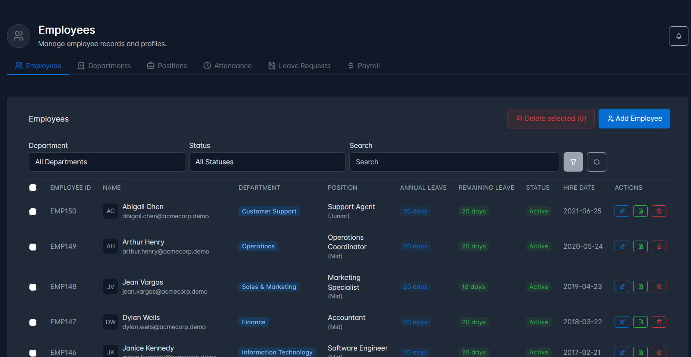
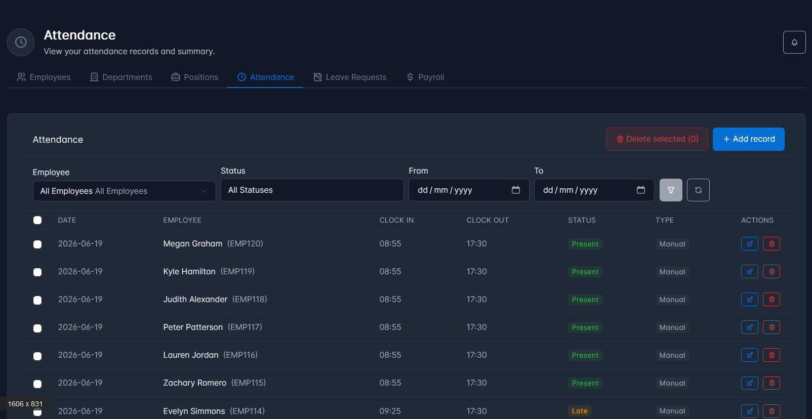
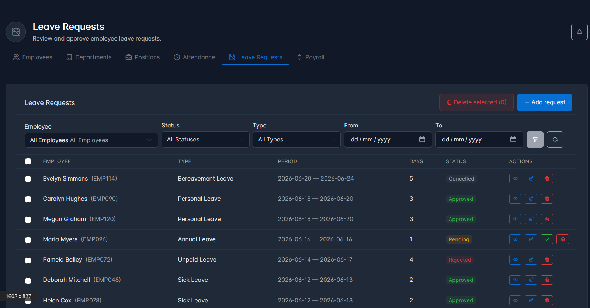
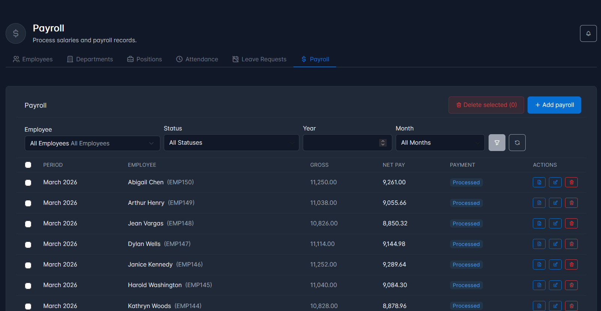

<p align="center">
  
</p>

<p align="center">
  <a href="https://wordpress.org/plugins/mf-staffcore-lite/"></a>
  <a href="https://wordpress.org/plugins/mf-staffcore-lite/"></a>
  <a href="https://www.php.net/"></a>
  <a href="https://www.gnu.org/licenses/gpl-2.0.html"></a>
</p>

Free HR for WordPress teams. Employees, attendance, leave, payroll, and assets, in a staff panel that also opens outside wp-admin. No employee cap.

**[Install on WordPress.org](https://wordpress.org/plugins/mf-staffcore-lite/)** · **[Pro edition](https://mehdifalahi.dev/product/mf-staffcore-wp)** · **[Author](https://mehdifalahi.dev)**

## Included in Lite

| Area | What you can do |
| --- | --- |
| People | Employee profiles, departments, and positions. No cap on headcount. |
| Team | Team Performance for managers, with My Team. |
| Time | Attendance records and leave requests. |
| Pay | Payroll, payslips, and employee self-service payslips. |
| Assets | Assets, categories, maintenance, and suppliers. |
| Access | Administrator, HR Manager, and Employee roles, including bulk-linking WordPress users. |
| Panel | Dashboard, company information, permissions, in-app notifications, and a responsive sidebar. |
| Frontend | The same HR UI on the public site, for logged-in staff. |

Employees open **My Profile**, **My Leave**, and **My Payslips** for their own records only.

## Lite and Pro

Lite is the free package on [WordPress.org](https://wordpress.org/plugins/mf-staffcore-lite/). HR data stays in your WordPress database. Lite has no telemetry and no license phone-home.

[MF StaffCore Pro](https://mehdifalahi.dev/product/mf-staffcore-wp) is a separate download: **$39 USD**, one-time, no license key. Pro adds:

- Documents
- Awards and recognition
- KPIs and performance reviews
- Backup and restore
- Biometric device sync

Activate only one edition on a site. Do not run Lite and Pro together.

## Screenshots

| Employees | Attendance |
| --- | --- |
|  |  |

| Leave requests | Payroll |
| --- | --- |
|  |  |

These are the current WordPress.org screenshots for the employee, attendance, leave, and payroll screens.

## Requirements

- WordPress 6.0 or newer (tested up to 7.0)
- PHP 8.1 or newer

## Installation

### From WordPress.org

1. In wp-admin, open **Plugins → Add New** and search for **MF StaffCore Lite**.
2. Install and activate it.
3. Open **StaffCore** in the admin menu.
4. If asked, link your WordPress user under **Settings → Users**, then set **Company Information** and **Permissions**.

Plugin directory: https://wordpress.org/plugins/mf-staffcore-lite/

### Upload a ZIP

Download the release ZIP from [GitHub Releases](https://github.com/mehdifalahi/mf-staffcore-lite/releases) or from WordPress.org. In wp-admin, use **Plugins → Add New → Upload Plugin**.

### From this repository

Place this project at:

`wp-content/plugins/mf-staffcore-lite`

The `vendor/` directory is already included, so the plugin runs without Composer. Activate **MF StaffCore Lite** on the Plugins screen.

Share the staff panel from **Settings → Frontend Panel**. Logged-in users with a StaffCore account see the menus their role allows. The public entry uses `mf_staffcore_front=1` on the site home URL.

## Translations

Text domain: `mf-staffcore-lite`.

Template: `languages/mf-staffcore-lite.pot`. How to add a locale: [languages/README.md](languages/README.md).

## Support

- Free edition: https://wordpress.org/support/plugin/mf-staffcore-lite/
- Pro edition: https://mehdifalahi.dev/product/mf-staffcore-wp
- Bugs in this package: [GitHub issues](https://github.com/mehdifalahi/mf-staffcore-lite/issues)

Leave real employee and payroll data out of public reports. Security reports go through [SECURITY.md](SECURITY.md).

## Development

This tree is the free package, version 0.1.13, aligned with the WordPress.org release.

Rebuild PHP dependencies only when you need a fresh `vendor/` directory:

```bash
composer install --no-dev
```

The plugin loads `vendor/autoload.php` when that file is present.

Full release history: [readme.txt](readme.txt).

### 0.1.13

- AJAX handlers verify the request nonce before reading POST data
- The frontend panel entry is a bookmarkable GET flag
- Activating Pro after Lite fills default permissions for the newly available Pro modules

## License

PHP code, and the HTML integrated with it, is licensed under the GNU General Public License v2.0 or later.

- Plugin header and [license.txt](license.txt)
- Full GPL text: [LICENSE](LICENSE) and [licensing/GPL-2.0.txt](licensing/GPL-2.0.txt)
- Bundled libraries: [licensing/third-party-licenses.md](licensing/third-party-licenses.md)

## Author

Mehdi Falahi

https://mehdifalahi.dev

https://profiles.wordpress.org/mehdifalahi/

https://wordpress.org/plugins/mf-staffcore-lite/